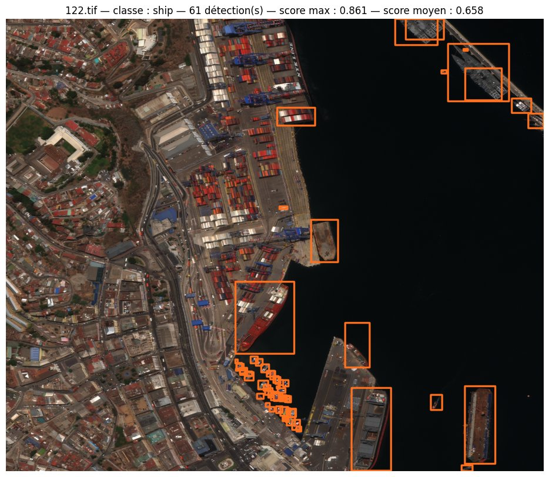
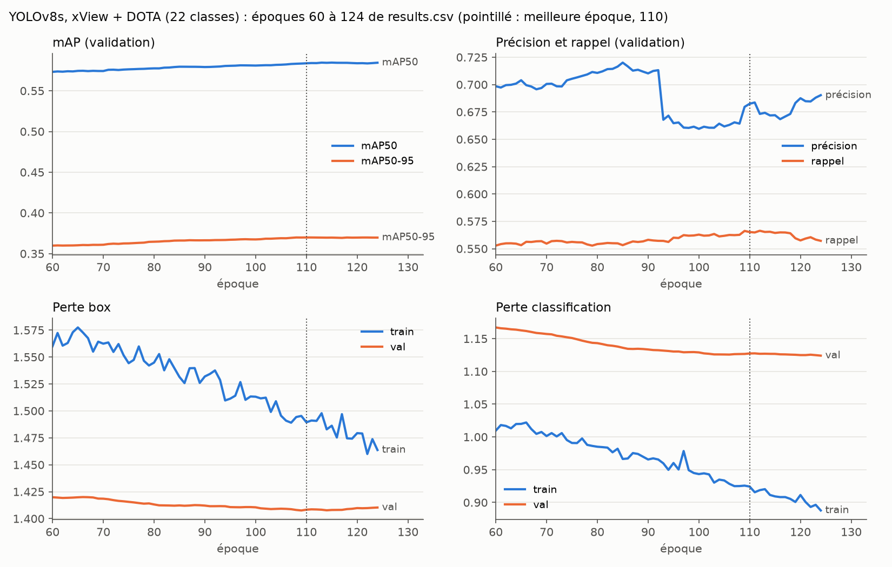
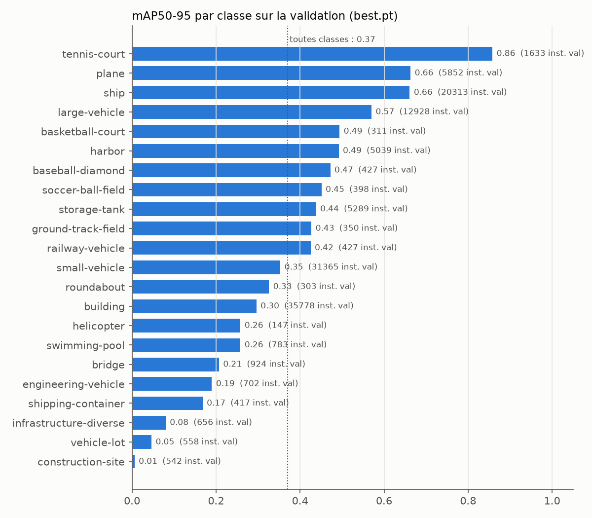
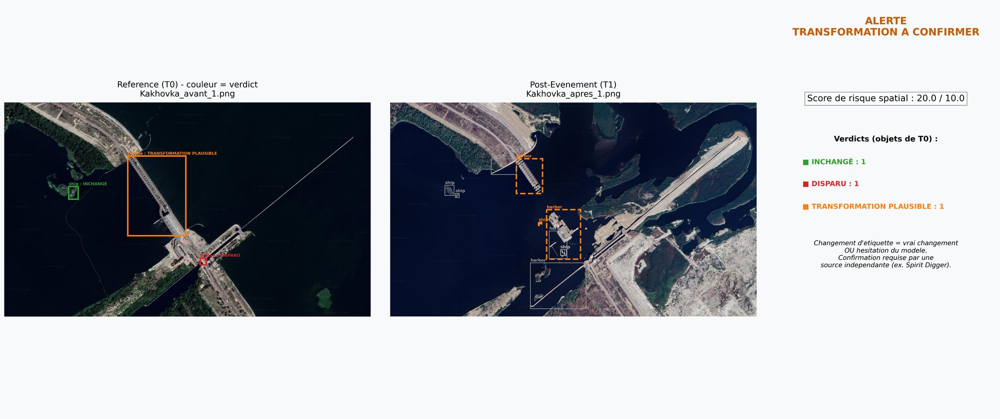

# God's Eye v2.0

> *Il regarde d'en haut. Il compte ce qui a changé.*

**Problème :** détecter des objets (navires, avions, véhicules, bâtiments, ponts, ports…) sur des images satellites optiques, puis comparer deux dates d'une même zone pour repérer ce qui a disparu, est apparu ou s'est transformé.
**Approche :** un détecteur YOLOv8s entraîné sur la fusion de deux jeux publics, **xView** et **DOTA**, ramenés à une taxonomie commune de **22 classes**, puis une couche d'analyse avant / après appliquée à la destruction du **barrage de Kakhovka** (6 juin 2023).

Ce projet est le pendant « image » de [**Spirit Digger**](https://github.com/mawuli100dev-hue/spirit_digger) (veille OSINT sur le texte).

---

## En 30 secondes

| | |
|---|---|
| **Données** | xView (846 images annotées) + DOTA v1, fusionnés en 22 classes ; 38 018 tuiles d'entraînement, 7 834 de validation (125 142 objets en validation) |
| **Séparation** | par **image source** pour xView (762 / 84 images), pour qu'aucune tuile d'une image de validation ne serve à l'entraînement |
| **Modèle** | YOLOv8s (11,1 M paramètres), 640 px, 2 × Tesla T4 (Kaggle) |
| **Résultat (validation)** | **mAP50 = 0,584 · mAP50-95 = 0,370 · précision = 0,682 · rappel = 0,565** (meilleure époque, 110) |
| **Point fort** | navires, avions, terrains de tennis : AP50 ≥ 0,89 |
| **Point faible** | classes rares ou mal définies (`construction-site`, `vehicle-lot`) : AP50 < 0,13 |
| **Démo** | barrage de Kakhovka : le pont-barrage « disparaît » et ses débris sont détectés comme `harbor` ; l'alerte demande une confirmation indépendante |



*Classe `ship` sur l'image xView 122 (port), inférence par tuiles avec SAHI, seuil 0,25 : 61 détections. Cette image n'a servi ni à l'entraînement ni à la validation. On voit aussi un faux positif : une rangée de conteneurs sur le quai, en haut, prise pour un navire.*

---

## Le problème

Une image satellite fait plusieurs milliers de pixels de côté et contient des centaines d'objets, souvent minuscules (une voiture couvre une dizaine de pixels à 30 cm de résolution). Deux questions :

1. **Détection :** quels objets, et où ? C'est le cœur du projet, mesuré par la mAP sur un jeu de validation annoté.
2. **Changement :** entre deux dates, qu'est-ce qui a disparu, est apparu ou a changé de nature ? Ici, il n'existe pas de vérité terrain : c'est une démonstration qualitative, construite au-dessus du détecteur.

## Données

| Jeu | Contenu | Licence |
|---|---|---|
| [xView](https://xviewdataset.org/) (DIUx / NGA, 2018) | images WorldView-3 à environ 30 cm, 60 classes, boîtes alignées sur les axes, annotations GeoJSON | CC BY-NC-SA 4.0 (usage non commercial) |
| [DOTA v1](https://captain-whu.github.io/DOTA/dataset.html) (Wuhan University) | images Google Earth et satellites chinois, 15 classes ; copie Kaggle déjà découpée en tuiles de 1024 px | usage académique uniquement, usage commercial interdit ; les images Google Earth suivent aussi les conditions de Google Earth |

Les données brutes et les poids ne sont **pas** dans ce dépôt.

**Préparation, dans l'ordre :**

1. **Conversion** des annotations xView (GeoJSON, coordonnées pixels) au format YOLO. Deux identifiants de classe absents de la liste officielle (75 et 82, 79 boîtes) sont écartés ([03](notebooks/03_conversion_geojson_yolo.ipynb)).
2. **Découpage en tuiles** de 640 px : une boîte n'est gardée que si au moins 30 % de sa surface est dans la tuile ([04](notebooks/04_tiling_v1.ipynb), version v1).
3. **Taxonomie unifiée à 22 classes** ([configs/data_merged.yaml](configs/data_merged.yaml)) : 6 classes communes aux deux jeux (`plane`, `helicopter`, `ship`, `storage-tank`, `small-vehicle`, `large-vehicle`), 9 propres à DOTA (`harbor`, `bridge`, terrains de sport, `roundabout`…) et 7 regroupements de classes xView (`building`, `vehicle-lot`, `railway-vehicle`, `shipping-container`, `engineering-vehicle`, `construction-site`, `infrastructure-diverse`). Une première version à 29 puis 38 classes ([05](notebooks/05_remapping_classes_v1.ipynb), [archive](archive/colab_v1/)) a été abandonnée.
4. **Séparation train / val par image source** ([06](notebooks/06_split_entrainement.ipynb)) : les 846 images xView sont tirées au hasard (graine 42), 10 % vont en validation, et **toutes les tuiles d'une image restent du même côté**. Sans cela, deux tuiles voisines, voire les deux moitiés d'un même objet coupé par le découpage, se retrouveraient de part et d'autre, et les métriques seraient gonflées. La liste est versionnée : [configs/split_sources.json](configs/split_sources.json). DOTA garde sa séparation officielle train / val.

Distribution (journal du notebook 06) : `building` (327 638 boîtes en train) et `small-vehicle` (253 258) dominent ; `roundabout` (801), `baseball-diamond` (873) ou `helicopter` (1 301) sont deux cents à quatre cents fois plus rares. Environ 41 % des tuiles d'entraînement ne contiennent aucun objet (15 582 sur 38 018).

## Méthode

| Paramètre | Valeur | Source |
|---|---|---|
| Modèle | YOLOv8s, initialisé avec les poids COCO (`yolov8s.pt`) | code du [notebook 06](notebooks/06_split_entrainement.ipynb) |
| Taille d'image | 640 | [results/run/args.yaml](results/run/args.yaml) |
| Batch | 32 (2 GPU) | args.yaml |
| Époques | 150 prévues, `patience=25` ; arrêt à l'époque 124 | args.yaml, results.csv |
| Optimiseur | `auto` (Ultralytics a choisi MuSGD, lr 0,01) | journal d'entraînement |
| Augmentations | réglages par défaut d'Ultralytics (mosaïque, HSV, translation, échelle, retournement horizontal) | args.yaml |
| Matériel | 2 × Tesla T4 sur Kaggle, environ 10 min par époque | journal d'entraînement |
| Logiciel | Ultralytics 8.4.163, PyTorch 2.10.0, Python 3.12.13 | journal d'entraînement |

Une session Kaggle dure au plus 12 heures. À chaque époque, le dossier du run est sauvegardé, et toutes les 5 époques il est publié comme nouvelle version d'un dataset Kaggle ; l'entraînement reprend ensuite avec `resume=True` ([notebook 06](notebooks/06_split_entrainement.ipynb), section 4).

À l'inférence sur des images entières, [SAHI](https://github.com/obss/sahi) découpe l'image en tuiles de 640 px avec 20 % de recouvrement et fusionne les détections ([07](notebooks/07_inference_sahi.ipynb)).

## Résultats

Validation : 7 834 tuiles, 125 142 objets. Sources exactes : [results/README.md](results/README.md).

| Époque | Précision | Rappel | mAP50 | mAP50-95 |
|---|---|---|---|---|
| **110** (meilleure mAP50-95) | 0,682 | 0,565 | 0,584 | **0,370** |
| 124 (dernière enregistrée) | 0,690 | 0,557 | 0,584 | 0,370 |

*Valeurs de [results/run/results.csv](results/run/results.csv), arrondies à trois décimales (mAP50-95 : 0,3699 à l'époque 110, 0,3697 à l'époque 124). La réévaluation de `best.pt` dans le notebook 06 donne les mêmes valeurs globales (0,682 / 0,565 / 0,583 / 0,370). Le fichier ne couvre que les époques 60 à 124, car l'entraînement a été repris depuis une sauvegarde.*



Sur les 65 dernières époques, la mAP50-95 ne gagne qu'un point (0,360 → 0,370) alors que la perte d'entraînement continue de baisser : le modèle est proche de son plateau pour cette taille et cette résolution.

**Par classe** (`best.pt`, [results/metrics_par_classe.csv](results/metrics_par_classe.csv)) :

| Classe | Instances (val) | Précision | Rappel | AP50 | AP50-95 |
|---|---:|---:|---:|---:|---:|
| tennis-court | 1 633 | 0,918 | 0,906 | 0,939 | 0,858 |
| ship | 20 313 | 0,856 | 0,924 | 0,925 | 0,661 |
| plane | 5 852 | 0,917 | 0,859 | 0,897 | 0,663 |
| harbor | 5 039 | 0,794 | 0,808 | 0,828 | 0,492 |
| large-vehicle | 12 928 | 0,773 | 0,755 | 0,804 | 0,570 |
| baseball-diamond | 427 | 0,741 | 0,738 | 0,760 | 0,472 |
| storage-tank | 5 289 | 0,840 | 0,662 | 0,743 | 0,438 |
| railway-vehicle | 427 | 0,657 | 0,747 | 0,739 | 0,425 |
| small-vehicle | 31 365 | 0,665 | 0,789 | 0,723 | 0,353 |
| ground-track-field | 350 | 0,657 | 0,663 | 0,650 | 0,427 |
| basketball-court | 311 | 0,697 | 0,585 | 0,623 | 0,494 |
| roundabout | 303 | 0,744 | 0,546 | 0,616 | 0,326 |
| building | 35 778 | 0,654 | 0,594 | 0,606 | 0,296 |
| swimming-pool | 783 | 0,669 | 0,656 | 0,595 | 0,258 |
| soccer-ball-field | 398 | 0,700 | 0,555 | 0,568 | 0,451 |
| bridge | 924 | 0,612 | 0,482 | 0,457 | 0,207 |
| helicopter | 147 | 0,277 | 0,551 | 0,425 | 0,258 |
| engineering-vehicle | 702 | 0,568 | 0,279 | 0,363 | 0,190 |
| shipping-container | 417 | 0,678 | 0,185 | 0,293 | 0,168 |
| infrastructure-diverse | 656 | 0,676 | 0,096 | 0,131 | 0,080 |
| vehicle-lot | 558 | 0,453 | 0,059 | 0,126 | 0,046 |
| construction-site | 542 | 0,464 | 0,002 | 0,019 | 0,006 |
| **toutes classes** | **125 142** | **0,682** | **0,565** | **0,583** | **0,370** |



Autres figures (prédictions par classe sur l'image xView 122, exploration, distribution des étiquettes) : [results/figures/](results/figures/).

## Détection de changement : Kakhovka

Le [notebook 08](notebooks/08_detection_changement.ipynb) compare deux images d'une même zone à partir des détections de `best.pt`.

- **Alerte par comptage (v1).** Différence du nombre d'objets par classe entre T0 et T1, pondérée : une infrastructure qui disparaît pèse 10, un véhicule 0,1. À Kakhovka : 2 `bridge` disparus, score 20 pour un seuil de 10, donc alerte.
- **Analyse des transformations (v2).** Chaque objet de T0 est apparié aux objets de T1 qui le recouvrent (part du plus petit objet couverte par l'autre, et non l'IoU : un petit débris posé sur l'emplacement d'un grand ouvrage doit compter comme « au même endroit »). Verdict par objet : INCHANGÉ, DISPARU, TRANSFORMATION PLAUSIBLE (`bridge` → `harbor` : débris) ou INCOHÉRENCE MODÈLE (`tennis-court` → `ship` : hésitation du détecteur). Une transformation plausible déclenche une alerte **à confirmer** par une source indépendante.



*Images Google Earth (© Google) avant et après la destruction du barrage. À gauche, les objets de T0 colorés par verdict ; à droite, les détections de T1.*

Le même notebook contient deux autres démonstrations (détection d'intrusion, chronologie T0 / T1 / T2), sur des séquences **construites pour la démonstration** à partir d'une seule image xView ou DOTA : [results/figures/](results/figures/).

## Limites

- **Petits objets.** `small-vehicle` a un rappel de 0,789 mais une AP50-95 de 0,353 : les voitures sont trouvées, mais leurs boîtes de 10 à 20 pixels sont imprécises, et l'AP50-95 pénalise fortement chaque pixel d'écart. En validation, les tuiles les plus denses contiennent jusqu'à 705 objets (avertissement d'Ultralytics dans le notebook 06).
- **Rappel inférieur à la précision** (0,565 contre 0,682). L'écart vient surtout de classes mal définies : `construction-site`, `vehicle-lot` et `infrastructure-diverse` ont une précision proche de 0,5 mais un rappel inférieur à 0,1. Ce sont des regroupements hétérogènes de classes xView, sans forme visuelle stable : le défaut vient de la taxonomie autant que du modèle.
- **Classes déséquilibrées.** `building` compte 400 fois plus d'exemples que `roundabout`. Aucune pondération des classes ni sur-échantillonnage n'a été testé.
- **Écart de domaine entre capteurs.** xView (WorldView-3, environ 30 cm) et DOTA (Google Earth, résolutions variables) n'ont ni la même résolution ni le même rendu. Le modèle n'a pas été évalué séparément sur chaque source, ni sur un capteur absent de l'entraînement : les images de Kakhovka (Google Earth) relèvent de ce cas et ne sont jugées que qualitativement.
- **Pas de classe « barrage ».** À Kakhovka, l'ouvrage est détecté comme `bridge` et ses débris comme `harbor` : la règle « bridge → harbor = transformation plausible » a été écrite pour ce cas.
- **Détection de changement non évaluée.** Les poids par classe et les seuils d'alerte sont des choix manuels, et aucun jeu annoté avant / après n'a servi à les mesurer.
- **Reproductibilité partielle.** Le notebook qui a produit le jeu final à 22 classes (dataset Kaggle `aerial-unified-22classes`) n'est pas encore dans le dépôt ; les notebooks 03 à 05 en montrent la démarche dans sa version v1. Les époques 1 à 59 ne figurent pas dans `results.csv`.

## Pistes

- **Images radar SAR (Sentinel-1).** Elles voient à travers les nuages et de nuit, ce qui compte pour une crue comme celle de Kakhovka. Il faudrait des jeux annotés en SAR (par exemple pour les navires) et des prétraitements propres au radar (speckle, polarisations).
- **Segmentation plutôt que boîtes** pour les objets sans contour net (zones inondées, chantiers, débris), où une boîte rectangulaire décrit mal la réalité.
- **Boîtes orientées.** DOTA fournit des boîtes orientées que la fusion avec xView a ramenées à des boîtes droites : un modèle orienté (YOLOv8-OBB) serait plus juste pour les navires et les ponts.
- **Évaluation par source et par capteur**, et une métrique pour la détection de changement sur un jeu annoté avant / après (par exemple xBD pour les dégâts sur les bâtiments).
- **Lien automatique avec Spirit Digger.** Spirit Digger produit déjà des demandes d'observation au format JSON (son notebook 06). Côté God's Eye, la confirmation externe est aujourd'hui un dictionnaire rempli à la main (`CONFIRMATION_EXTERNE` dans le notebook 08) : lire ces demandes automatiquement est une prochaine étape, **pas encore implémentée**.

## Reproduire

```bash
python -m venv .venv
.venv\Scripts\activate            # Windows ; sous Linux / macOS : source .venv/bin/activate
pip install -r requirements.txt
jupyter lab
```

**Données.** xView : [xviewdataset.org](https://xviewdataset.org/) (inscription requise) ; DOTA v1 : [captain-whu.github.io/DOTA](https://captain-whu.github.io/DOTA/dataset.html). Les notebooks ont tourné sur Kaggle (copies `hassanmojab/xview-dataset` et `kefanzhan/dotav1`) et Google Colab. Chaque notebook commence par une cellule de configuration dont les valeurs par défaut sont les chemins d'origine ; en local, définir `GOD_EYE_INPUT`, `GOD_EYE_WORK` et `GOD_EYE_WEIGHTS`, ou `DATA_LAKE` pour les notebooks Colab.

**Poids.** `best.pt` (67 Mo, époque 110) : **[lien de la Release GitHub à ajouter]**. Ils dérivent de xView et DOTA et suivent donc leurs conditions d'usage non commerciales.

**Ordre des notebooks :**

| NB | Étape | Plateforme |
|---|---|---|
| [01](notebooks/01_exploration_xview.ipynb) | exploration de xView | Kaggle |
| [02](notebooks/02_exploration_dota.ipynb) | exploration de DOTA | Colab |
| [03](notebooks/03_conversion_geojson_yolo.ipynb) | conversion GeoJSON → YOLO | Colab |
| [04](notebooks/04_tiling_v1.ipynb) | découpage en tuiles (v1) | Colab |
| [05](notebooks/05_remapping_classes_v1.ipynb) | regroupement des classes (v1) | Colab |
| [06](notebooks/06_split_entrainement.ipynb) | séparation par image source, entraînement, évaluation par classe | Kaggle, 2 × T4 |
| [07](notebooks/07_inference_sahi.ipynb) | inférence par tuiles sur de grandes images (SAHI) | Kaggle |
| [08](notebooks/08_detection_changement.ipynb) | détection de changement (Kakhovka) | Kaggle |

Les essais intermédiaires (YOLOv8n à 60 classes, YOLOv8s à 29 classes, fusion à 38 classes, première détection de changement) sont dans [archive/](archive/).

## Arborescence

```
notebooks/      pipeline numéroté 01 → 08
configs/        data_merged.yaml (22 classes), split_sources.json (séparation train / val)
results/        métriques, courbes, figures ; run/ : args.yaml, results.csv, mosaïques
archive/        notebooks de la v1 (Colab) et première version de l'application
RAPPORT/        présentation du projet (PDF)
```

## Licence

Code sous licence [MIT](LICENSE). Les données (xView : CC BY-NC-SA 4.0 ; DOTA : usage académique uniquement) et les poids qui en dérivent ne sont pas couverts par cette licence et suivent les conditions de leurs auteurs.

**Citer les jeux de données :**
- Lam et al., *xView: Objects in Context in Overhead Imagery*, arXiv:1802.07856, 2018.
- Xia et al., *DOTA: A Large-scale Dataset for Object Detection in Aerial Images*, CVPR 2018.
